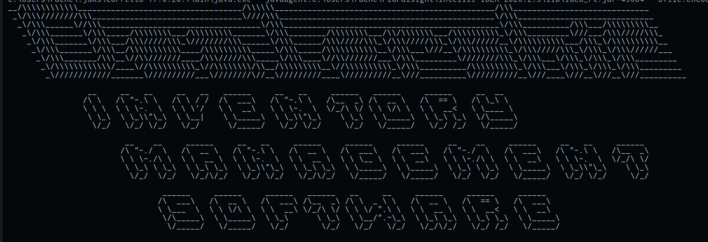
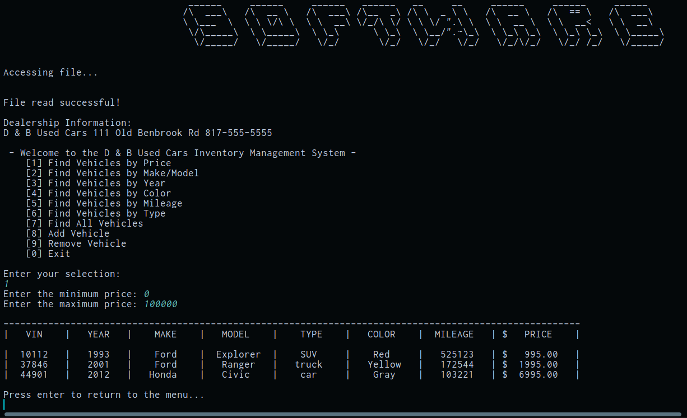

# CAR DEALERSHIP
This is a command line application which acts as a dealership database manager. It allows the user to search through vehicles using various search parameters, view vehicle lists, add new vehicles, and delete vehicles.


### Key Features:
- Read and write to a given dealership inventory list
- View all vehicles within the inventory, or filter for specific vehicles
- Add new vehicles
- Delete vehicles with the VIN
- Display vehicles lists in a nice table format


### How to Run it:
1. Open 'car-dealership.java' in IntelliJ
2. Click 'run' while in the App.java file
3. The menu will be displayed, type your selection then hit enter
4. Additional prompts will pop up, depending on which option selected. Type the requested information then hit enter. 
   1. A list of vehicles will pop up according to your search parameters OR
   2. You may enter the information to add a new vehicle to the inventory, or you may remove a vehicle from the inventory using the VIN


### Interesting Code:
I love tables.
```java
private void displayVehicles(ArrayList<Vehicle> inventory) {
        if (!inventory.isEmpty()) {
            System.out.println();
            System.out.println( "-------------------------------------------------------------------------------------------------------" );
            System.out.printf("|%s|%s|%s|%s|%s|%s|%s| $%s|%n", center("VIN", 10),
                    center("YEAR", 10),
                    center("MAKE", 12),
                    center("MODEL", 12),
                    center("TYPE", 12),
                    center("COLOR", 12),
                    center("MILEAGE", 12),
                    center("PRICE", 12));
            System.out.println();

            for (Vehicle vehicle : inventory) {
                System.out.printf("|%s|%s|%s|%s|%s|%s|%s| $%s|%n",
                        center(Integer.toString(vehicle.getVin()), 10),
                        center(Integer.toString(vehicle.getYear()), 10),
                        center(vehicle.getMake(), 12),
                        center(vehicle.getModel(), 12),
                        center(vehicle.getVehicleType(), 12),
                        center(vehicle.getColor(), 12),
                        center(Integer.toString(vehicle.getOdometer()), 12),
                        center(vehicle.getPrice().toString(), 12));
            }
        } else {
            System.out.println("No vehicles found matching this request.");
        }

        pressEnterToContinue();

    }
```

I used the ASCII art generator to create the banner, then I added the \t tabs to make it look a bit nicer.
```java
public static void displayBanner() {
        System.out.println("""
                __/\\\\\\\\\\\\\\\\\\\\\\\\___________________________________/\\\\\\\\\\\\_______________________________________________/\\\\\\_____________________________       \s
                 _\\/\\\\\\////////\\\\\\________________________________\\////\\\\\\______________________________________________\\/\\\\\\_____________________________      \s
                  _\\/\\\\\\______\\//\\\\\\__________________________________\\/\\\\\\______________________________________________\\/\\\\\\__________/\\\\\\___/\\\\\\\\\\\\\\\\\\__     \s
                   _\\/\\\\\\_______\\/\\\\\\_____/\\\\\\\\\\\\\\\\___/\\\\\\\\\\\\\\\\\\_______\\/\\\\\\________/\\\\\\\\\\\\\\\\___/\\\\/\\\\\\\\\\\\\\___/\\\\\\\\\\\\\\\\\\\\_\\/\\\\\\_________\\///___/\\\\\\/////\\\\\\_    \s
                    _\\/\\\\\\_______\\/\\\\\\___/\\\\\\/////\\\\\\_\\////////\\\\\\______\\/\\\\\\______/\\\\\\/////\\\\\\_\\/\\\\\\/////\\\\\\_\\/\\\\\\//////__\\/\\\\\\\\\\\\\\\\\\\\___/\\\\\\_\\/\\\\\\\\\\\\\\\\\\\\__   \s
                     _\\/\\\\\\_______\\/\\\\\\__/\\\\\\\\\\\\\\\\\\\\\\____/\\\\\\\\\\\\\\\\\\\\_____\\/\\\\\\_____/\\\\\\\\\\\\\\\\\\\\\\__\\/\\\\\\___\\///__\\/\\\\\\\\\\\\\\\\\\\\_\\/\\\\\\/////\\\\\\_\\/\\\\\\_\\/\\\\\\//////___  \s
                      _\\/\\\\\\_______/\\\\\\__\\//\\\\///////____/\\\\\\/////\\\\\\_____\\/\\\\\\____\\//\\\\///////___\\/\\\\\\_________\\////////\\\\\\_\\/\\\\\\___\\/\\\\\\_\\/\\\\\\_\\/\\\\\\_________ \s
                       _\\/\\\\\\\\\\\\\\\\\\\\\\\\/____\\//\\\\\\\\\\\\\\\\\\\\_\\//\\\\\\\\\\\\\\\\/\\\\__/\\\\\\\\\\\\\\\\\\__\\//\\\\\\\\\\\\\\\\\\\\_\\/\\\\\\__________/\\\\\\\\\\\\\\\\\\\\_\\/\\\\\\___\\/\\\\\\_\\/\\\\\\_\\/\\\\\\_________\s
                        _\\////////////_______\\//////////___\\////////\\//__\\/////////____\\//////////__\\///__________\\//////////__\\///____\\///__\\///__\\///__________
                
                \t\t\t\t __     __   __     __   __   ______     __   __     ______   ______     ______     __  __                       \s
                \t\t\t\t/\\ \\   /\\ "-.\\ \\   /\\ \\ / /  /\\  ___\\   /\\ "-.\\ \\   /\\__  _\\ /\\  __ \\   /\\  == \\   /\\ \\_\\ \\                      \s
                \t\t\t\t\\ \\ \\  \\ \\ \\-.  \\  \\ \\ \\'/   \\ \\  __\\   \\ \\ \\-.  \\  \\/_/\\ \\/ \\ \\ \\/\\ \\  \\ \\  __<   \\ \\____ \\                     \s
                \t\t\t\t \\ \\_\\  \\ \\_\\\\"\\_\\  \\ \\__|    \\ \\_____\\  \\ \\_\\\\"\\_\\    \\ \\_\\  \\ \\_____\\  \\ \\_\\ \\_\\  \\/\\_____\\                    \s
                \t\t\t\t  \\/_/   \\/_/ \\/_/   \\/_/      \\/_____/   \\/_/ \\/_/     \\/_/   \\/_____/   \\/_/ /_/   \\/_____/                    \s
                
                \t\t\t\t\t\t __    __     ______     __   __     ______     ______     ______     __    __     ______     __   __     ______ \s
                \t\t\t\t\t\t/\\ "-./  \\   /\\  __ \\   /\\ "-.\\ \\   /\\  __ \\   /\\  ___\\   /\\  ___\\   /\\ "-./  \\   /\\  ___\\   /\\ "-.\\ \\   /\\__  _\\\s
                \t\t\t\t\t\t\\ \\ \\-./\\ \\  \\ \\  __ \\  \\ \\ \\-.  \\  \\ \\  __ \\  \\ \\ \\__ \\  \\ \\  __\\   \\ \\ \\-./\\ \\  \\ \\  __\\   \\ \\ \\-.  \\  \\/_/\\ \\/\s
                \t\t\t\t\t\t \\ \\_\\ \\ \\_\\  \\ \\_\\ \\_\\  \\ \\_\\\\"\\_\\  \\ \\_\\ \\_\\  \\ \\_____\\  \\ \\_____\\  \\ \\_\\ \\ \\_\\  \\ \\_____\\  \\ \\_\\\\"\\_\\    \\ \\_\\\s
                \t\t\t\t\t\t  \\/_/  \\/_/   \\/_/\\/_/   \\/_/ \\/_/   \\/_/\\/_/   \\/_____/   \\/_____/   \\/_/  \\/_/   \\/_____/   \\/_/ \\/_/     \\/_/\s
                
                \t\t\t\t\t\t\t\t ______     ______     ______   ______   __     __     ______     ______     ______                              \s
                \t\t\t\t\t\t\t\t/\\  ___\\   /\\  __ \\   /\\  ___\\ /\\__  _\\ /\\ \\  _ \\ \\   /\\  __ \\   /\\  == \\   /\\  ___\\                             \s
                \t\t\t\t\t\t\t\t\\ \\___  \\  \\ \\ \\/\\ \\  \\ \\  __\\ \\/_/\\ \\/ \\ \\ \\/ ".\\ \\  \\ \\  __ \\  \\ \\  __<   \\ \\  __\\                             \s
                \t\t\t\t\t\t\t\t \\/\\_____\\  \\ \\_____\\  \\ \\_\\      \\ \\_\\  \\ \\__/".~\\_\\  \\ \\_\\ \\_\\  \\ \\_\\ \\_\\  \\ \\_____\\                           \s
                \t\t\t\t\t\t\t\t  \\/_____/   \\/_____/   \\/_/       \\/_/   \\/_/   \\/_/   \\/_/\\/_/   \\/_/ /_/   \\/_____/                           \s
                
                """);
    }
```


### Screenshots:

